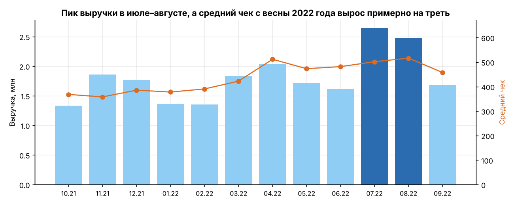
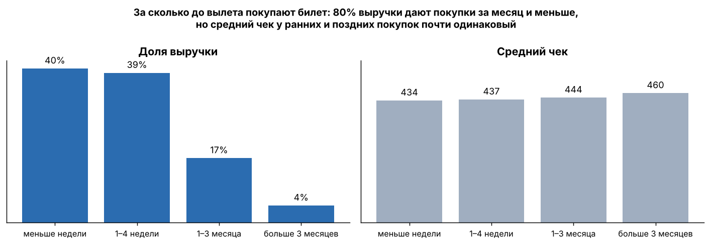
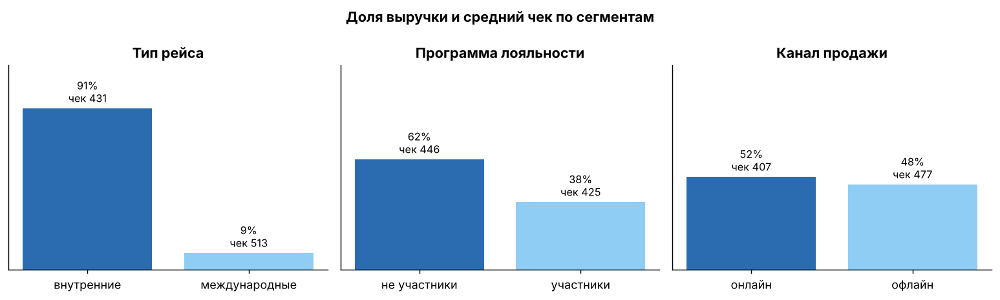

# Продажи авиабилетов: сезонность, глубина бронирования, сегменты

Контрольная работа по анализу данных, 3 курс СПбГЭУ.

[English version below](#english)

## Задача и данные

50 000 продаж билетов одной авиакомпании с октября 2021 по сентябрь 2022 года. Для каждой продажи известны дата покупки и вылета, тип пассажира, сумма (значения масштабированы с сохранением пропорций), города вылета и прилёта, тип рейса, участие в программе лояльности, канал продажи. Нужно было разобраться, от чего зависит выручка и когда покупают билеты.

## Выводы

**1. Пик выручки в июле–августе, а билеты за год заметно подорожали.** В эти два месяца продаж в полтора раза больше, чем в среднем. Средний чек весной 2022 года вырос с 370–390 до 470–510, и так и остался на новом уровне. То есть рост выручки летом дали и сезон, и цена.

**2. Билеты покупают поздно, но поздняя покупка не дороже ранней.** 40% выручки дают покупки меньше чем за неделю до вылета и ещё 39% покупки за 1–4 недели. При этом средний чек во всех группах почти одинаковый (434–460), у самых ранних покупок он даже немного выше. Поздние покупки дают больше выручки только за счёт количества. В первой версии работы я сделал из t-теста вывод, что авиакомпания «зарабатывает на поздних покупках», но разбивка по среднему чеку показывает, что дело в объёме.

**3. Офлайн-билеты дороже, участники программы лояльности тратят меньше.** Внутренние рейсы дают 91% выручки. Средний чек офлайн на 17% выше, чем онлайн (477 против 407). Участники программы лояльности приносят 38% выручки, и средний чек у них немного ниже, чем у остальных. Программу стоит оценивать по частоте полётов, а не по чеку.

**4. Основная выручка идёт с маршрутов в Сочи и Новосибирск.** Топ внутренних направлений: Сочи ↔ Москва и Новосибирск ↔ Москва. На международных рейсах преобладают страны СНГ.

## Как делал

Предобработка (типы дат, пропуски, дубликаты, нулевая выручка), отчёты по выручке в разрезах, выбросы (boxplot, Q-Q, тест Шапиро–Уилка, удалены только экстремальные 0,1%), проверка гипотез (осень против зимы: различий нет, p = 0,15), сегментация по глубине бронирования, топ направлений с координатами аэропортов из OpenFlights.

## Что бы улучшил

Выручка сильно скошена, поэтому для сравнения групп надёжнее тест Манна–Уитни или bootstrap, чем t-тест. Связь выручки с категориальными признаками лучше мерить через V Крамера или η², а не через корреляцию Кендалла.

## Файлы

- `notebooks/airline_sales_analysis.ipynb`: анализ.
- `scripts/make_figures.py`: графики для README.
- `data/air_data.csv`: данные.

Python, pandas, SciPy, matplotlib, seaborn.

---

## English

**Airline ticket sales, Oct 2021 – Sep 2022 (50k tickets).**

Revenue peaks in July–August, and the average fare jumped by about a third in spring 2022 and stayed there. 79% of revenue comes from tickets bought less than a month before departure, but the average fare is almost the same across booking windows, so late bookings matter because of volume, not price. Offline tickets are 17% more expensive than online, and domestic routes bring 91% of revenue.
