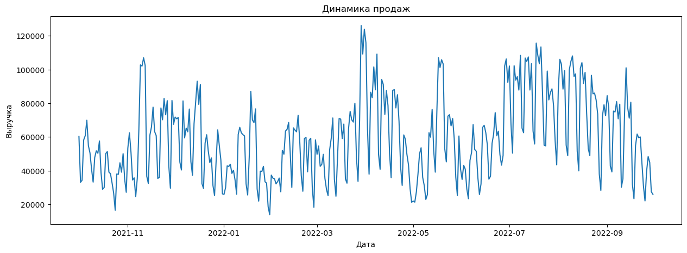
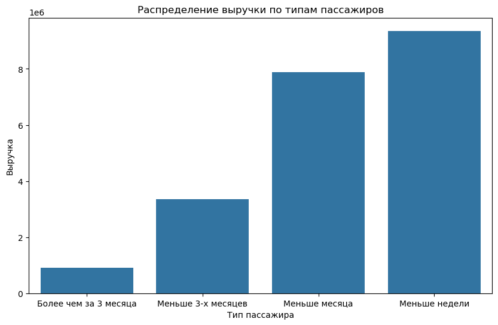
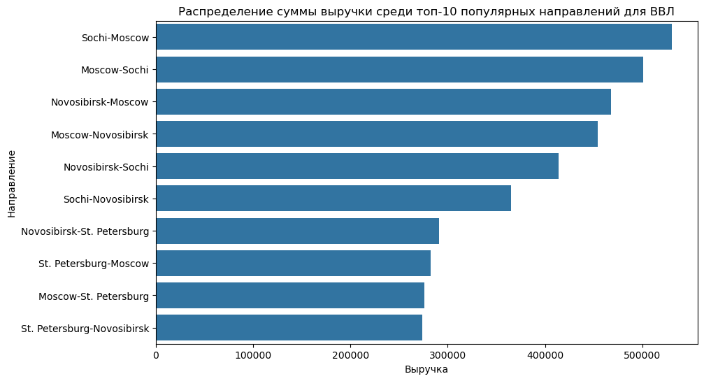

# Анализ продаж авиабилетов: сезонность, глубина бронирования, направления

🇷🇺 Русский · [🇬🇧 English](#-english)

**Задача.** Исследовать продажи авиакомпании: динамику и сезонность выручки, влияние программы лояльности, канала продаж и глубины бронирования, а также самые доходные направления.

**Данные.** 50 000 покупок билетов с октября 2021 по сентябрь 2022: дата покупки и вылета, тип пассажира, выручка (значения скорректированы с сохранением пропорций), города вылета и прилёта, тип рейса (ВВЛ/МВЛ), участие в программе лояльности, канал продажи.

**Формат.** Индивидуальная контрольная работа, курс «Анализ данных», 3 курс.



## Что сделано

1. **Предобработка:** типы дат, пропуски (в том числе 60% пропусков в признаке лояльности, обработанные как отдельная категория), дубликаты, нулевая выручка.
2. **Отчёты по выручке** в разрезе лояльности, типа рейса и канала продаж.
3. **Выбросы и распределение:** boxplot, KDE, Q-Q plot, тест Шапиро–Уилка. Удалены только экстремальные выбросы (0,1% данных), чтобы минимизировать потери.
4. **Сезонность:** выручка и число продаж по сезонам и месяцам, t-тест «осень vs зима», ранговая корреляция Кендалла.
5. **Глубина бронирования:** сегментация пассажиров по разнице между датой покупки и датой вылета (4 группы) и проверка гипотезы о различии выручки.
6. **Топ-10 направлений** для внутренних и международных рейсов; поиск координат аэропортов через открытый датасет OpenFlights.

## Ключевые результаты

- **Сезонность:** пик выручки приходится на июль–сентябрь, минимум на зиму. Выручка осенью и зимой статистически не различается (p = 0,15).
- **Глубина бронирования:** больше всего выручки приносят покупки менее чем за неделю до вылета, меньше всего покупки более чем за 3 месяца. Различие значимо (p < 0,001), то есть авиакомпания зарабатывает на поздних покупках.
- **Направления:** внутренние рейсы лидируют по выручке весь период. Топ внутренних маршрутов: Сочи ↔ Москва, Новосибирск ↔ Москва. Среди международных преобладают рейсы в страны СНГ.
- **Лояльность:** клиенты вне программы лояльности суммарно приносят больше выручки, а онлайн- и офлайн-продажи сопоставимы.

<p>


</p>

## Ограничения и что бы я улучшил

- Выручка сильно скошена, поэтому для сравнения групп надёжнее тест Манна–Уитни или bootstrap, чем t-тест.
- Корреляцию Кендалла с закодированными категориальными признаками лучше заменить на η² или Cramér's V.

## Стек

Python · pandas · NumPy · SciPy · seaborn · matplotlib

## Как запустить

```bash
pip install pandas numpy scipy seaborn matplotlib jupyter
jupyter notebook notebooks/airline_sales_analysis.ipynb
```

---

## 🇬🇧 English

**Airline ticket sales: seasonality, booking window and top routes**

**Data.** 50,000 ticket purchases, Oct 2021 – Sep 2022 (revenue values scaled, proportions preserved). Individual university assignment.

**What was done.** Data cleaning; revenue reports by loyalty programme, flight type and sales channel; outlier analysis (Shapiro–Wilk, Q-Q plots); seasonality testing; booking-window segmentation with hypothesis testing; top-10 domestic and international routes.

**Key findings**
- Revenue peaks in July–September. Autumn and winter revenue do not differ significantly (p = 0.15).
- Last-minute purchases (< 1 week before departure) bring the most revenue, and the difference between booking-window groups is significant (p < 0.001).
- Domestic flights lead throughout the period: Sochi ↔ Moscow and Novosibirsk ↔ Moscow are the top routes. International traffic is dominated by CIS destinations.

**Next steps.** Mann–Whitney or bootstrap instead of t-tests on skewed revenue; Cramér's V for categorical associations.

**Stack:** Python, pandas, NumPy, SciPy, seaborn, matplotlib.
